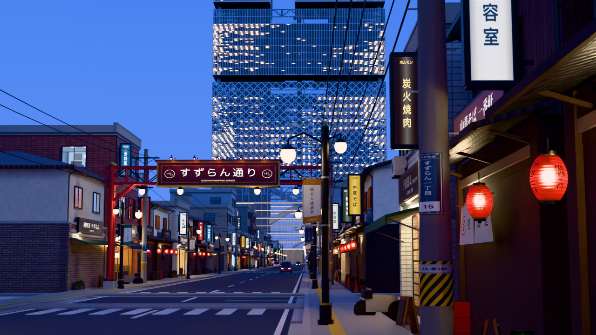

# Playground



A procedural Japanese townscape built with plain Three.js, hosting any of the
repository's architectural models at real 1:1 scale across nine civic plots
(three rows of three).

The district pairs an Osaka Dotonbori & Shinsaibashi-inspired flagship
*Shotengai* promenade (herringbone granite pavers, undergrounded utilities,
one-of-a-kind 3D culinary & theatre landmarks, luxury glass boutiques, Taisho
heritage brick dining, timber *machiya* izakayas with *noren* curtains and
*chochin* lanterns, corner *kissaten* cafes, and neighborhood commercial
sub-centers)
with subdivided residential blocks of six *ikkodate* detached-house archetypes
(*kirizuma* clay-tile roofs, *katanagare* galvalume monoslopes with rooftop PV,
two-tone *yosemune* hipped roofs, 3-storey urban *kyosho-jutaku*, traditional
timber-and-plaster houses, and L-shaped courtyard homes with carports, hedges,
gateposts, and kei-cars).

## Run

Serve the repository root (or this folder) and open `/streets/web/`:

```bash
npm run serve               # python3 -m http.server 8123
# http://localhost:8123/streets/web/
```

`assets` is a symlink to `../../model_viewer/assets`, where the optimized browser GLBs
live, so the page works from either the repository root or this directory.

## Use

| | |
|---|---|
| Palette | click a model (or press `1`–`5`) to place it on the next free plot |
| In scene | click a row to frame that model; `●`/`○` hides it, `×` removes it |
| Views | `Street` (`S`), `Shotengai` (`M`), `Ikkodate` (`H`), `Overview` (`O`) |
| Walk | `Walk` (`F`): first-person at 1.7 m — `WASD` move, `Shift` run, mouse look, `Esc` back to orbit. `Space` jumps; double-tap it to fly (Minecraft creative style): in flight `WASD` follows the look direction, `Space` climbs, `Shift` descends, and touching down lands |
| Clear scene | removes every placed model |

## Default model

Use the `model` query parameter to choose the building loaded on startup. For
example:

- `/streets/web/?model=house` — Highrise House
- `/streets/web/?model=abeno` — Abeno Harukas
- `/streets/web/?model=office` — Office Tower
- `/streets/web/?model=pompidou` — Centre Pompidou
- `/streets/web/?model=stack` — The Stack

Without the parameter, or with an unknown model ID, the scene loads The Stack.

The street network, commercial hubs, residential lots, and overhead utility
lines are generated deterministically from a fixed seed, merged per material to
keep draw calls low.

## Notes

- Loading uses `GLTFLoader` + the meshopt decoder for the optimized web GLBs.
- Glass is alpha-blended rather than transmissive: the exported
  `KHR_materials_transmission` is swapped for `transparent` panes that keep the
  model's own colour (`opacity` 0.32, low metalness, `envMapIntensity` 0.6), so
  the facade stays see-through without the extra full-scene render WebGL
  transmission needs. Time of day never changes the glass — the 24 h cycle only
  moves lights and sky — while the exported lamp panels brighten at night as
  they do in the model viewer.
- Models are grounded on their authored origin (`+0.02 m` above the plaza
  surface) rather than `Box3.setFromObject`, avoiding rotated merged-mesh AABB
  offsets.
